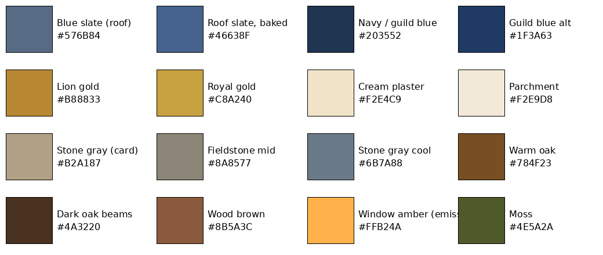

# VARNETHRYL building style guide (card style + realism)

Sources, in priority order:
1. **Official building cards** (26, from the boss, Oct 24): `cards/card_*.{jpg,png}`. These are the main spec.
2. **Realism references** (4, from the boss): `ref/village_street.jpg`, `ref/farmhouse_barn.jpg`, `ref/lighthouse.jpg`, `ref/castle.jpg`.
3. Older hero cards: `/workspace/sheets/upgraded/*_detailed.png`, used for the gold/navy heraldry only.

## Palette
The values were sampled from the Village Houses card palette strip, plus the hex values the boss quoted.

| Use | Hex |
|---|---|
| Blue slate roof (card) | #576B84; it bakes to #46638F so it still reads blue after ACES |
| Navy / guild blue (banners, trims) | #203552, #1F3A63, #1E3A6A |
| Lion gold / royal gold | #B88833, #C8A240, #C9A96E |
| Cream plaster | #F2E4C9 (baked a little darker, to #E6D6B8 × 0.86) |
| Parchment (UI only) | #F2E9D8 |
| Stone gray | #B2A187 (warm, card), #6B7A88 (cool, keep/walls), fieldstone mix #5F5D58–#A39C8C |
| Warm oak / dark beams | #784F23 / #4A3220, wood brown #8B5A3C |
| Window glow | #E0A040 albedo + #FFB24A emissive |
| Moss / dirt | #4E5A2A / #3B3226 |

## Materials
- **Ground floor:** grey weathered fieldstone. Irregular stones in varied colours with recessed dark mortar, moss in the joints, and a dirt and moss band in the bottom 1.2 m.
- **Upper floors:** cream plaster infill between dark oak beams (hand-hewn timber framing), with light rain streaking.
- **Roofs:** steep blue slate in overlapping rows with mossy patches. Use tall stone chimneys.
- **Windows:** warm amber leaded glass, emissive, roughness 0.25.
- **Heraldry:** navy banners with a gold rampant lion and gold border and fringe.
- **Stone-only buildings** (keep, gatehouse, lighthouse, temple, library, mage academy, town hall, treasury, observatory, crypt, colosseum): all fieldstone, with blue conical slate roofs on the towers.
- **Barn, stables, windmill:** stone base with oak plank upper walls.
- **Streets:** cobblestone. Also low dry-stone walls, post-and-rail fences, barrels and flower boxes (props are not done yet).
- **Silhouette:** steep gables, cross gables with dormers, jettied upper floor, round towers with cones and crenellations.

## Tileable texture sets (for Lucky)
`www/proto3d/models/beth/textures/realmed/`: fieldstone, cobblestone, slate, plaster_timber, oak. Each set has albedo (JPG), normal (PNG, OpenGL +Y), roughness and height, all 1024 and seamless. `banner_lion_albedo.jpg` is 512x1024.
The generator is `tools/texgen.py` and is deterministic.

## Status (Oct 24, 11:40 PM ET)
- Texture/material pass done for all 27 round-4 hi buildings and 16 Tripo houses. Each is saved as `*_card.glb` + `_card_lod1/_lod2` with one material, 2048/1024/512 maps (Tripo houses use 1024/512/256), and 2 lion banners on the front.
- Before/after (batch 1): `shots/compare_{house1,inn,smithy,bakery,apothecary,guildhall}.png`, `shots/contact_batch1.jpg`.
- NOT done: rebuilding the geometry to match each card's silhouette (gables, dormers, jetties, chimneys, arched doors, signs). Missing buildings with no model yet: fountain monument, port, town walls & watchtowers.
